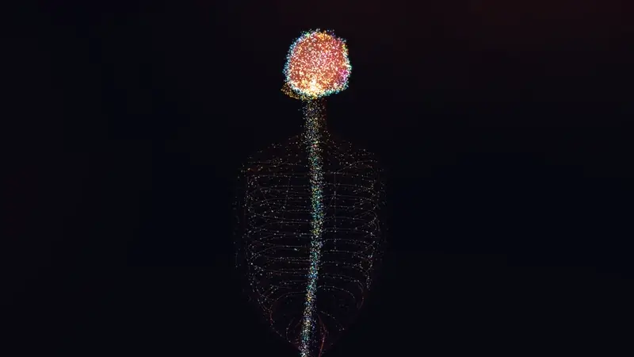
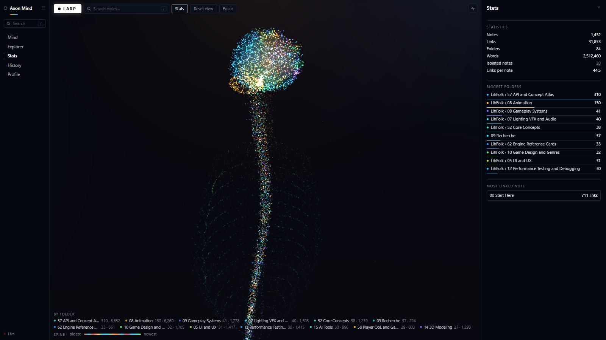

# Axon Mind



An Obsidian plugin that shows every note in your vault as a 3D particle cloud (three.js):
a brain on a glowing spine made of your notes in time order, plus molecule, grid, curve, wheel, flow
and lifelines, with animated transitions.
English by default, French available (*Français disponible* : View panel → Language).



## Install

### Option 1 — with BRAT (easiest, auto-updates)

1. In Obsidian: Settings → Community plugins → Browse → install and enable **BRAT**.
2. Command palette (Ctrl/Cmd + P) → **BRAT: Add a beta plugin for testing**.
3. Paste this and confirm:

   ```
   Lord-Yoxo/axon-mind
   ```

4. Settings → Community plugins → enable **Axon Mind**.

### Option 2 — manually

1. Download `axon-mind-<version>.zip` from the [latest release](https://github.com/Lord-Yoxo/axon-mind/releases/latest) and unzip it.
2. Put the `axon-mind` folder (with `manifest.json`, `main.js`, `styles.css` inside) in
   `<your vault>/.obsidian/plugins/` — the `.obsidian` folder is hidden: show hidden files if needed.
3. Restart Obsidian (or Settings → Community plugins → reload), turn off Restricted mode if asked,
   then enable **Axon Mind**.

Open it with the brain icon in the ribbon, or the command palette → "Axon Mind: Open Axon Mind".

## What you get

- **Intro**: every note collapses into a single point ("Every mind starts as one dot."), "Loading your vault… %",
  an explosion into a close-up of the brain, the camera pulls back to reveal the body, then
  "<n> thoughts. One brain.". Click or press Esc to skip.
- **8 forms** (View panel → Form, or keys 1–8):
  1. **Brain**: notes form the brain (one region per folder) on a long glowing **spine**: every note in time
     order, the oldest at the tip, the newest under the brain, bigger notes brighter. Fine luminous fibres (your
     links) run through the brain, and a soft halo (**Glow** slider) gives it volume. A glass-like wire-frame
     body — short neck, broad shoulders, torso — can be shown around it (**Shell** slider), with a glowing
     **skeleton** (ribs, sternum, collarbones, shoulder blades, pelvis) and **nerves** branching from the spine to
     the shoulders, along the ribs and down the back (**Skeleton** slider). The **Body** slider goes from brain
     only to the full view; the Notes and Spine switches show or hide each part.
  2. **Molecule**: one glowing nebula per folder — a dense, bright core with the most linked notes, a coloured
     haze around it — set apart by dark space, with your [[links]] as filaments between them, stars in between
     and boxed labels.
  3. **Grid**: one block of points per folder, names on the left.
  4. **Curve**: a filled wave of points per day of modification (log scale: the peak stands out, small days
     stay visible), tilted dates, folders on the right.
  5. **Wheel**: two styles (View panel → Wheel style): **Slices** — one coloured slice per folder, filled with
     its notes, names around, the wheel turns; **Clock** — one ring per folder, the time of modification goes
     around the dial.
  6. **Flow**: each note flows from its folder to the folder it links to most.
  7. **Lifelines**: one line per folder; each note lives from its first to its last known date, arcs link the
     days the folder changed.
  8. **Microscope**: each folder is a cell — a sphere filled with its notes, with a glowing membrane and a
     nucleus — packed like a sunflower around the biggest one, in a slowly turning Petri dish seen at an angle.
  Each form shows a question and its answer computed from your vault.
- **LARP** (top left, or key L): cycles through the 8 forms, 2 seconds each, on a loop — made for filming.
  With **LARP colours** on (default), each form gets its own single hue — red, green, blue… — and your usual
  colours come back when LARP stops.
- **Focus** (top left, or key F): Axon Mind fills the whole Obsidian window. Click again, F or Esc to go back.
- **Reset view** (or key R): puts the camera back after zooming or rotating.
- **Signals**: glowing beads travel along the links between notes, like nerve impulses.
- **Menu** (left): Mind, Explorer, Stats, History, Profile. The ☰ button hides it; a red dot shows the view
  is live (amber while it updates), with what is highlighted and a **Clear** link.
- **Explorer**: your folder tree with counts; click a folder to highlight its notes, unfold it to see its notes,
  click a note to open its card.
- **Note card** (click a point): title, folder, dates, words, an excerpt, tags, **Open the note**, **Zoom to
  note** (the camera flies to it and stops turning) and its linked notes; the note and its neighbours are
  highlighted. Double-click or Ctrl/Cmd + click opens the note directly (or turn on "Click opens the note" in
  the plugin settings).
- **History** ("Writing history"): one bar per day, week or month — notes created and edited; click a bar to
  highlight those notes (and their part of the spine). "Topics over time" stacks the bars by folder or tag.
  While it is open, the brain is coloured by date (red = old, green = recent).
- **Stats**: notes, links, folders, words, isolated notes, biggest folders, most linked note.
- **Profile**: how many of your notes are linked, words written, busiest day, favourite weekday and hour, hubs,
  short notes and notes without links (one click highlights them).
- Hover a point: note name. Drag: rotate. Scroll: zoom. Right-drag: pan. Search with `/`, Enter opens the card
  of the first match. Esc clears the highlight.
- Bottom: legend (by folder, subfolder or tag — notes · links); click one to highlight it. Under it, the spine's
  colours from oldest to newest.
- **View panel** (right): colour theme, brightness, glow, quality, **Notes by** folder / subfolder / tag / date /
  size / links / **single colour** (the whole scene in one hue of the palette, the most linked notes shining
  white), **Spine by** same as notes / folder / date, 9 palettes, form, Body, Notes / Spine switches,
  Shell, Skeleton, **split into subfolders** (pick which folders count each subfolder as its own folder — none by default),
  labels, hide isolated notes, rotation, speed, breathing, LARP colours, links, signals, clouds, dust, point
  size, language, intro.
- The view updates by itself when a note is created, edited, renamed or deleted.

## Privacy

Everything stays on your computer. Axon Mind reads your notes' paths, dates, sizes, tags, links and word counts
to draw the view; it sends nothing over the network and stores only its own settings (in the plugin's
`data.json`).

## Build from source

Sources live in `src/`. `main.js` is generated (it bundles three.js, MIT licence):

```
npm install
npm run build
```

## Licence

MIT.
